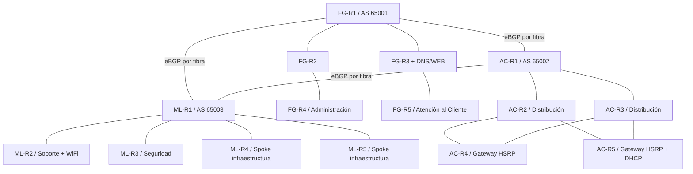
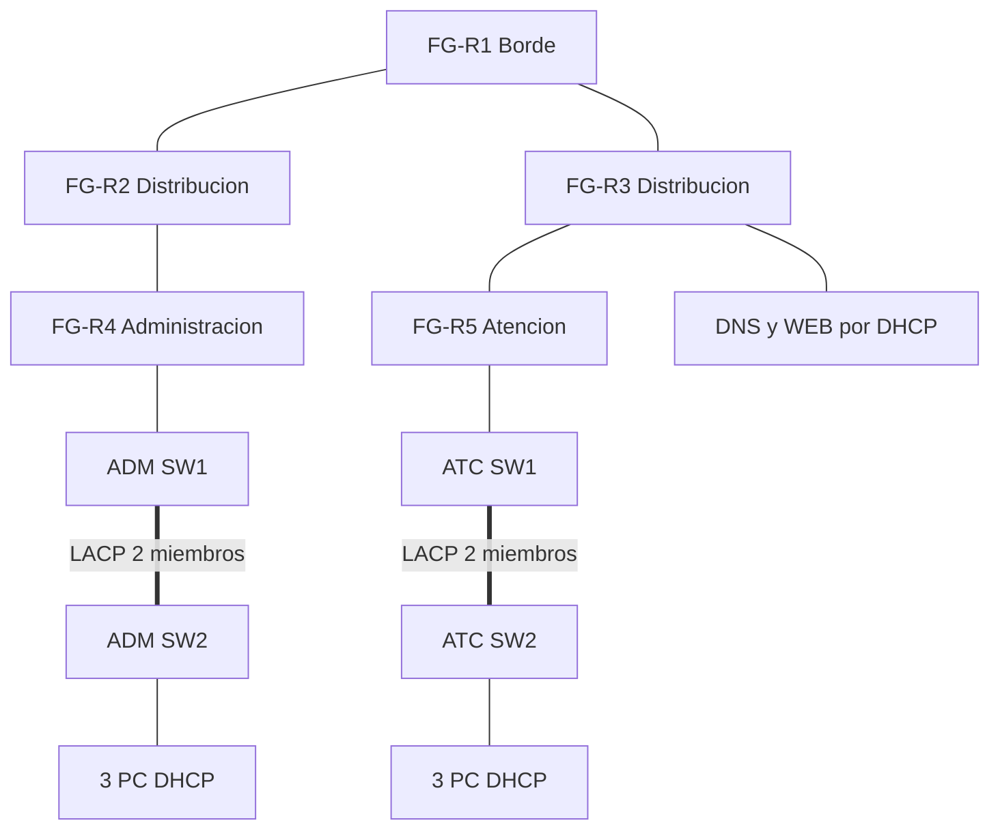
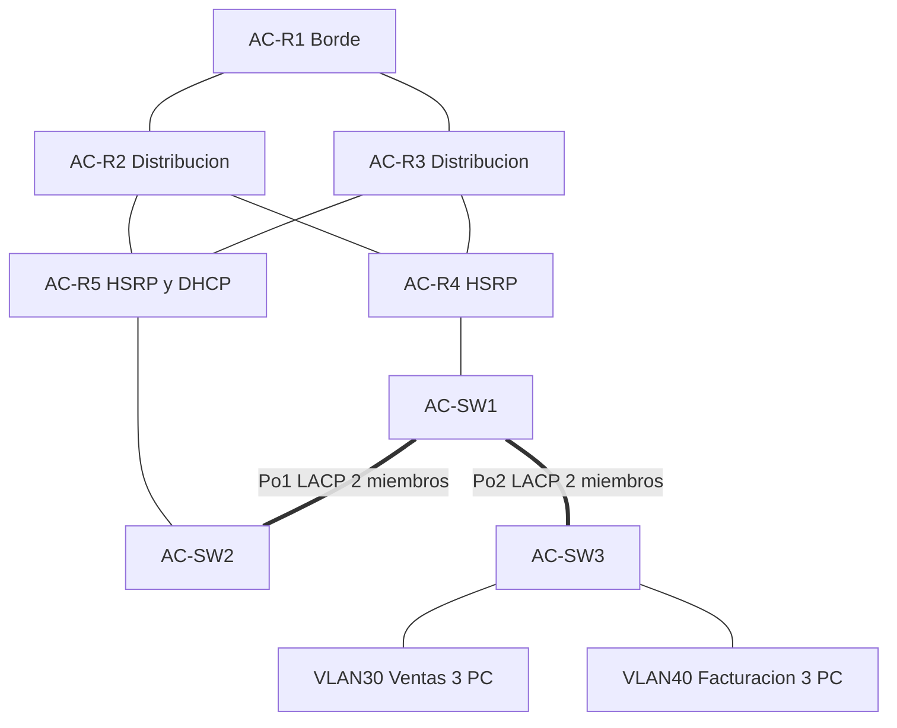
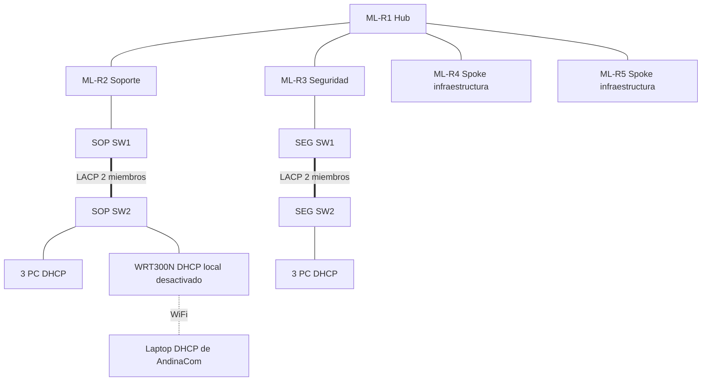

# Manual técnico — Conectividad XXI

Sergio Sandoval · 202010298 · Universidad de San Carlos de Guatemala · Redes de Computadoras 2 · 2S2026.

**Estado:** implementación de Packet Tracer validada. [Resultados de las pruebas](evidencias/RESULTADOS.md), [captura real de la topología](evidencias/topologia_completa.png) y [configuraciones efectivas leídas de IOS](configs_aplicadas/). Wireshark está completo: [análisis de las 42 tramas reales](Wireshark/ANALISIS_WIRESHARK.md), con cinco imágenes obtenidas dentro de la VM.

## Interpretación del enunciado

Se implementan los tres operadores especificados en las secciones detalladas, con OSPF en FibraNet GT y AndinaCom y EIGRP en MoonLink. Las menciones generales de cuatro ISP o RIP no sustituyen los requisitos específicos.

La expresión `192.168.98.0/16` contiene bits de host: el prefijo normalizado es `192.168.0.0/16`. Se conserva el identificador 98 del carné y se asignan enlaces /30 dentro de `192.168.98.0/24`; las interfaces de infraestructura adicionales permanecen dentro del /16. Las máscaras /30 evitan poner varios enlaces físicos en una misma subred.

La red completa de FibraNet `172.16.18.0/24` se divide en dos /25. Una /26 solo soporta 62 direcciones útiles y no cumple los 75 hosts exigidos. MoonLink utiliza /26, con 62 direcciones útiles para superar los 45 hosts exigidos. En AndinaCom se eligen /26 por departamento y se dejan dos /26 para crecimiento.

## Arquitectura

FibraNet forma un árbol de cinco routers. AndinaCom utiliza núcleo, distribución redundante y gateways HSRP. MoonLink utiliza un hub con cuatro spokes. El router inalámbrico se añade a los cinco routers enrutadores de MoonLink; no se depende de contarlo como uno de esos cinco.

Cada ISP cuenta con seis PC cableadas, tres por departamento. MoonLink añade una laptop WiFi. Un servidor de FibraNet presta DNS y HTTP/HTTPS. Se diseñan dos grupos LACP independientes por ISP, cada uno con dos enlaces físicos.

## Subneteo departamental

| Departamento | VLAN | Red | Máscara | Gateway | Broadcast | Hosts útiles |
|---|---:|---|---|---|---|---:|
| Administración | 10 | 172.16.18.0/25 | 255.255.255.128 | 172.16.18.1 | 172.16.18.127 | 126 |
| Atención al Cliente | 20 | 172.16.18.128/25 | 255.255.255.128 | 172.16.18.129 | 172.16.18.255 | 126 |
| Ventas | 30 | 172.16.28.0/26 | 255.255.255.192 | 172.16.28.1 (HSRP) | 172.16.28.63 | 62 |
| Facturación | 40 | 172.16.28.64/26 | 255.255.255.192 | 172.16.28.65 (HSRP) | 172.16.28.127 | 62 |
| Soporte | 50 | 172.16.32.0/26 | 255.255.255.192 | 172.16.32.1 | 172.16.32.63 | 62 |
| Seguridad | 60 | 172.16.32.64/26 | 255.255.255.192 | 172.16.32.65 | 172.16.32.127 | 62 |

Las primeras 19 direcciones útiles de cada subred de FibraNet y AndinaCom se excluyen del pool DHCP para gateways y futura infraestructura. En MoonLink se excluyen solo las primeras nueve. FibraNet conserva 107 concesiones por departamento, suficientes para 75 clientes; MoonLink conserva 53, suficientes para 45.

La tabla completa de interfaces está en `diseno/direccionamiento.json`; los archivos `.cfg` son la fuente de comandos planeados. Las direcciones realmente concedidas se documentarán tras consultar el servidor DHCP y cada host.

## Servicios centralizados

El servicio DHCP se ejecuta en AC-R5, loopback `192.168.98.254/32`. Los gateways de cada departamento usan `ip helper-address 192.168.98.254`. Los hosts finales se configuran como clientes DHCP, sin recurrir a IP estática como alternativa a una concesión fallida.

El servidor DNS/WEB está en FibraNet, subred de infraestructura `192.168.98.240/30`. El router FG-R3 ocupa `.241`; el único cliente posible recibe `.242` por DHCP desde AndinaCom. Así DNS tiene una dirección predecible sin configurar una IP estática en el servidor. Esta pequeña subred no consume los /25 departamentales.

El registro A previsto es `www.proyecto2_202010298.com → 192.168.98.242`. El sitio debe mostrar nombre, carné, curso, universidad y descripción del proyecto. Deben probarse HTTP y HTTPS.

## BGP e IGP

Los tres bordes forman un triángulo eBGP, AS 65001/65002/65003. Se anuncian los agregados departamentales /24 mediante una ruta de descarte local y la sentencia BGP `network`. FibraNet anuncia además la /30 de servicios, y AndinaCom la /32 del servidor DHCP.

Los bordes redistribuyen las rutas BGP aprendidas hacia OSPF o EIGRP. No se ejecuta el IGP sobre los enlaces eBGP. EIGRP recibe una métrica semilla explícita. Las interfaces hacia clientes son pasivas para evitar adyacencias no deseadas.

Los seis enlaces internos redundantes de AndinaCom tienen costos OSPF 1, 2, 4, 8, 16 y 32, en el mismo orden que la tabla de enlaces. Ambos extremos de cada enlace usan el mismo costo. Esto selecciona una ruta principal determinista y conserva las rutas de respaldo al converger después de una falla.

## LACP y HSRP

FibraNet y MoonLink utilizan un par de switches por departamento y un Port-channel con dos FastEthernet en modo LACP activo. AndinaCom utiliza Po1 entre AC-SW1 y AC-SW2, y Po2 entre AC-SW1 y AC-SW3. Los trunks solo transportan sus VLAN departamentales.

AC-R4 y AC-R5 son gateways redundantes para las VLAN 30 y 40. R4 tiene prioridad mayor en Ventas y R5 en Facturación. `preempt` permite recuperar el rol preferido. El seguimiento de ambos uplinks reduce la prioridad ante fallas. Apagar R4 debe mantener el gateway virtual y el servidor DHCP en R5. Apagar R5 conserva gateways en R4, pero interrumpe nuevas concesiones DHCP: HSRP no replica el servicio DHCP ni sus bindings. Esta limitación debe explicarse en la defensa.

## Política ACL y dirección de aplicación

Las ACL extendidas se aplican **in** en `GigabitEthernet6/0` de FG-R4, FG-R5, ML-R2 y ML-R3. En AndinaCom se aplican **in** en las subinterfaces `.30` y `.40` de **ambos** gateways. Así una conmutación HSRP no elimina la política y se detiene el tráfico cerca de su origen.

La regla que impide iniciar comunicación hacia Seguridad tiene prioridad sobre las autorizaciones generales de Administración y Soporte. Se permiten ICMP echo-reply y TCP con `established` hacia Seguridad para devolver respuestas a sus sesiones. `established` inspecciona ACK/RST; no constituye un firewall con seguimiento completo de estado.

| Origen | Destino | Resultado previsto |
|---|---|---|
| Seguridad | Cualquier otro departamento | ICMP, HTTP y HTTPS permitidos |
| Cualquier otro | Seguridad | Inicio bloqueado; respuestas permitidas |
| Administración o Soporte | Otros, salvo inicio hacia Seguridad | ICMP, HTTP y HTTPS |
| Atención al Cliente | Ventas | ICMP y HTTP |
| Facturación | Ventas | ICMP y HTTP |
| Atención al Cliente | Facturación | Bloqueado en ambos sentidos |

DNS y DHCP se permiten expresamente para no romper los servicios obligatorios. El DNS/WEB pertenece a una red de servicios y debe ser accesible desde todos los departamentos. Las reglas de respuesta TCP y los bloqueos específicos se evalúan antes de los permisos generales. Todos los demás paquetes quedan sujetos a denegación explícita.

En las ACL de AndinaCom también se permite UDP/1985 entre las direcciones físicas de los gateways y el grupo HSRP `224.0.0.2`. Esta excepción es indispensable: filtrar esos mensajes provoca que ambos gateways se crean activos. La verificación final confirma un activo y un respaldo por grupo antes de inyectar la falla.

## Red inalámbrica

ML-WIFI se conecta por `Ethernet 1` a la VLAN 50, usando su función de acceso inalámbrico y puente de LAN. Su servidor DHCP local se desactiva para que AndinaCom sea el único origen de concesiones. No se usa el puerto Internet ni NAT para los clientes departamentales.

La laptop utiliza un módulo `Linksys-WPC300N`, el SSID de laboratorio `Default` y DHCP en `Wireless0`. Además de colocarla junto al router en el diagrama lógico, fue necesario situarla dentro de su cobertura en el espacio físico de Packet Tracer. La dirección final se consulta en la tabla de concesiones verificadas. Una puesta en producción requiere definir autenticación y cifrado WiFi, no reutilizar el perfil abierto del laboratorio.

## Pruebas que deben quedar registradas

1. `show ip interface brief`, `show ip route`, vecinos OSPF/EIGRP, `show ip bgp summary` y rutas BGP.
2. `show etherchannel summary`: seis grupos LACP en estado agregado, dos miembros activos por grupo.
3. `show standby brief` en ambos gateways, seguido de una falla controlada y restauración.
4. DHCP DORA y `show ip dhcp binding`: máscara, gateway y DNS correctos en todos los hosts, incluido el servidor y la laptop.
5. Resolución del dominio y carga HTTP/HTTPS desde al menos un host de cada departamento.
6. Matriz dirigida de ping entre los seis departamentos. Los resultados bloqueados son resultados esperados, no fallas de conectividad global.
7. Pruebas TCP/80 y TCP/443 con un servicio escuchando. Un timeout hacia una PC sin servidor HTTP no demuestra un bloqueo ACL.
8. Falla de un miembro de cada Port-channel: el enlace lógico debe seguir funcionando.
9. WiFi: asociación de laptop al router inalámbrico y DHCP recibido exclusivamente desde AndinaCom.

## Análisis en modo simulación

- DHCP: Discover, Offer, Request, ACK; UDP 68/67; el relay incluye la dirección del gateway para seleccionar el pool.
- DNS: consulta por nombre, respuesta A, TTL y UDP/53; observar primero la resolución y luego la conexión web.
- HTTP: TCP/80, handshake TCP y petición GET legible. HTTPS: TCP/443 y contenido protegido por TLS.
- OSPF: protocolo IP 89, formación de adyacencias y anuncios del estado de enlaces.
- EIGRP: protocolo IP 88, vecinos y actualización de rutas con métrica compuesta.
- BGP: TCP/179, OPEN, KEEPALIVE y UPDATE; distinguir AS_PATH de la métrica interna.

## Captura Wireshark

Se preparó Ubuntu 24.04 en VMware Workstation, con 2 CPU, 2 GB de RAM, disco de 12 GB y adaptador E1000 en NAT. Wireshark/Tshark 4.2.2 capturó 42 tramas reales en `ens64`. El [análisis completo](Wireshark/ANALISIS_WIRESHARK.md) identifica direcciones, puertos, flags, secuencias y TTL. TCP: tramas 1–3; DNS: 10 y 13; HTTP: 4 y 6; TLS: 17, 19, 20, 26 y 28; ICMP: cuatro solicitudes y cuatro respuestas. El archivo pcapng, metadatos, registros y cinco imágenes están en `Wireshark/`. La VM permanece fuera del repositorio, al igual que su clave privada de administración.

## Diagramas por operador

### FibraNet GT

### AndinaCom

### MoonLink

## Tabla de enlaces enrutados por fibra

| Extremo A | Interfaz A | IP A | Extremo B | Interfaz B | IP B | Subred |
|---|---|---|---|---|---|---|
| FG-R1 | GigabitEthernet2/0 | 192.168.98.17 | FG-R2 | GigabitEthernet0/0 | 192.168.98.18 | 192.168.98.16/30 |
| FG-R1 | GigabitEthernet3/0 | 192.168.98.21 | FG-R3 | GigabitEthernet0/0 | 192.168.98.22 | 192.168.98.20/30 |
| FG-R2 | GigabitEthernet1/0 | 192.168.98.25 | FG-R4 | GigabitEthernet0/0 | 192.168.98.26 | 192.168.98.24/30 |
| FG-R3 | GigabitEthernet1/0 | 192.168.98.29 | FG-R5 | GigabitEthernet0/0 | 192.168.98.30 | 192.168.98.28/30 |
| AC-R1 | GigabitEthernet2/0 | 192.168.98.33 | AC-R2 | GigabitEthernet0/0 | 192.168.98.34 | 192.168.98.32/30 |
| AC-R1 | GigabitEthernet3/0 | 192.168.98.37 | AC-R3 | GigabitEthernet0/0 | 192.168.98.38 | 192.168.98.36/30 |
| AC-R2 | GigabitEthernet1/0 | 192.168.98.41 | AC-R4 | GigabitEthernet0/0 | 192.168.98.42 | 192.168.98.40/30 |
| AC-R2 | GigabitEthernet2/0 | 192.168.98.45 | AC-R5 | GigabitEthernet0/0 | 192.168.98.46 | 192.168.98.44/30 |
| AC-R3 | GigabitEthernet1/0 | 192.168.98.49 | AC-R4 | GigabitEthernet1/0 | 192.168.98.50 | 192.168.98.48/30 |
| AC-R3 | GigabitEthernet2/0 | 192.168.98.53 | AC-R5 | GigabitEthernet1/0 | 192.168.98.54 | 192.168.98.52/30 |
| ML-R1 | GigabitEthernet2/0 | 192.168.98.65 | ML-R2 | GigabitEthernet0/0 | 192.168.98.66 | 192.168.98.64/30 |
| ML-R1 | GigabitEthernet3/0 | 192.168.98.69 | ML-R3 | GigabitEthernet0/0 | 192.168.98.70 | 192.168.98.68/30 |
| ML-R1 | GigabitEthernet4/0 | 192.168.98.73 | ML-R4 | GigabitEthernet0/0 | 192.168.98.74 | 192.168.98.72/30 |
| ML-R1 | GigabitEthernet5/0 | 192.168.98.77 | ML-R5 | GigabitEthernet0/0 | 192.168.98.78 | 192.168.98.76/30 |
| FG-R1 | GigabitEthernet0/0 | 192.168.98.1 | AC-R1 | GigabitEthernet0/0 | 192.168.98.2 | 192.168.98.0/30 |
| FG-R1 | GigabitEthernet1/0 | 192.168.98.5 | ML-R1 | GigabitEthernet0/0 | 192.168.98.6 | 192.168.98.4/30 |
| AC-R1 | GigabitEthernet1/0 | 192.168.98.9 | ML-R1 | GigabitEthernet1/0 | 192.168.98.10 | 192.168.98.8/30 |

Las configuraciones exactas por interfaz, incluidas las LAN, se consultan en `diseno/direccionamiento.json` y `configs_aplicadas/`.
