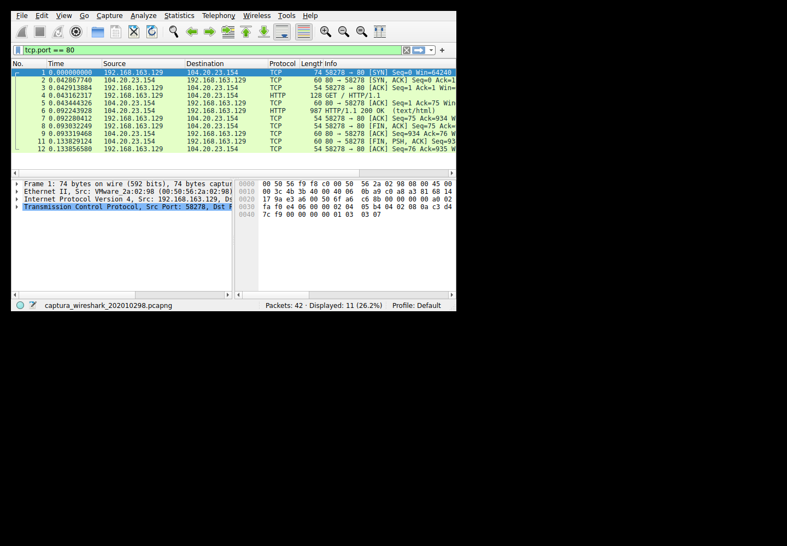
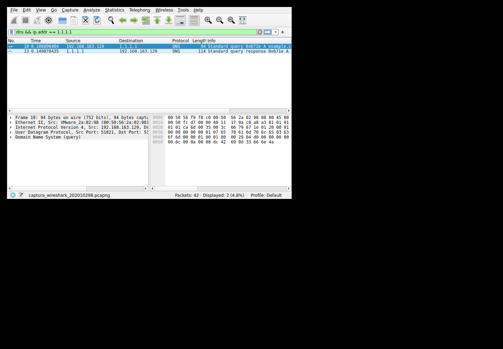
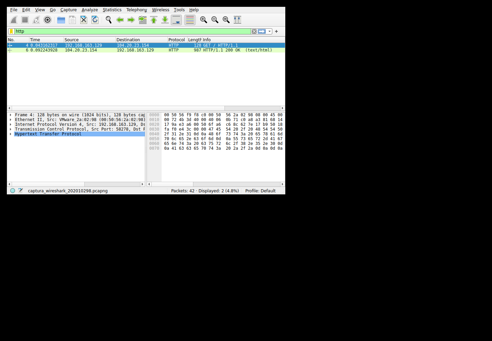
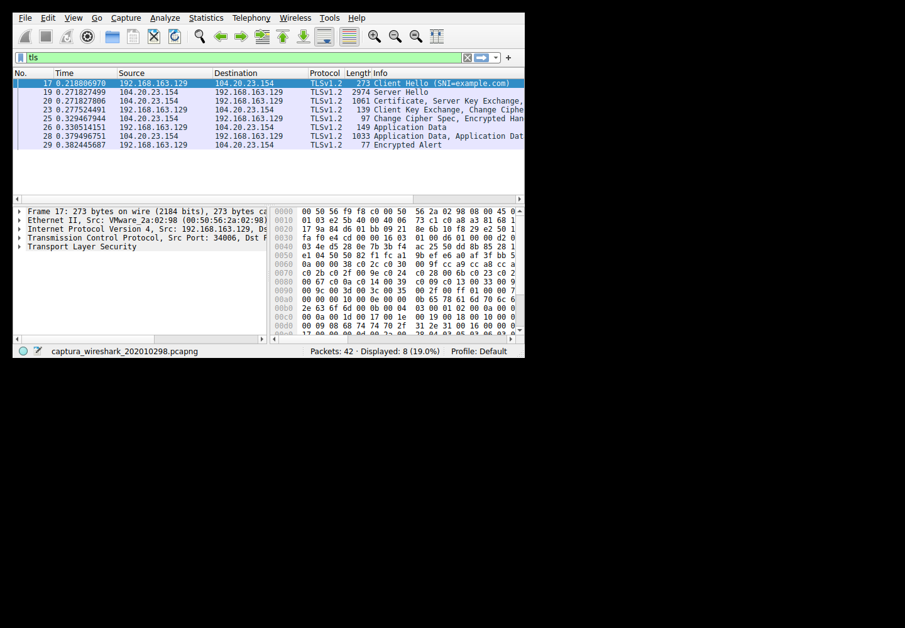
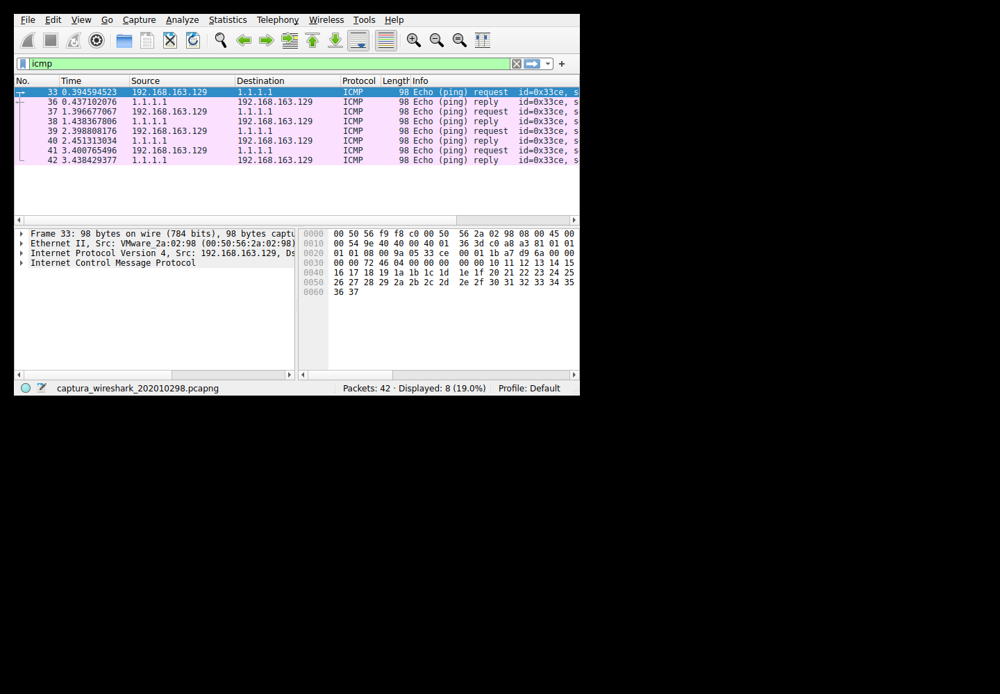

# Análisis de tráfico real con Wireshark

Sergio Sandoval · Carné 202010298 · Redes de Computadoras 2 · Proyecto 2

## Procedencia y validación

- Archivo: `captura_wireshark_202010298.pcapng`. Formato pcapng verificado con Capinfos y mediante su cabecera binaria.
- Contiene **42 tramas reales**. Primera trama: **2026-10-22 00:03:06 -0600**, hora de Guatemala.
- SHA-256: `57ce9b2ada772c95edef46cb8d7211f7d66d9a9813f8e2cc73a811392035a68f`.
- Captura realizada con Dumpcap/Tshark de Wireshark 4.2.2 dentro de Ubuntu 24.04, ejecutado en VMware Workstation. `systemd-detect-virt` devolvió `vmware`.
- Interfaz capturada: `ens64`, dirección `192.168.163.129`. La VM usa exclusivamente un adaptador NAT, con gateway `192.168.163.2`.
- Se limitó la captura a la VM y los destinos de prueba. Se excluyen la administración SSH, las descargas de actualizaciones y las interfaces de Windows. El filtro exacto se conserva en `entorno_vm.txt`.
- Los paquetes se generaron durante la captura mediante curl, dig y ping. No se construyeron paquetes artificiales ni se utilizó una captura ajena.
- `capinfos.txt`, `paquetes.json` y `escenarios.log` permiten contrastar las cifras y comandos. Las imágenes muestran la interfaz gráfica real de Wireshark ejecutándose en una pantalla virtual dentro de la VM.

## 1. Three-way handshake TCP

Flujo `tcp.stream == 0`: `192.168.163.129:58278 → 104.20.23.154:80`. Wireshark muestra números de secuencia relativos:

| Trama | Dirección | Flags | SEQ | ACK |
|---|---|---|---:|---:|
| 1 | Cliente a servidor | SYN | 0 | 0 |
| 2 | Servidor a cliente | SYN, ACK | 0 | 1 |
| 3 | Cliente a servidor | ACK | 1 | 1 |

El SYN anuncia el inicio de la conexión. SYN-ACK reconoce ese inicio y anuncia el del servidor. El ACK final confirma ambos extremos. Un SYN consume una posición de la secuencia, por eso el reconocimiento avanza a 1 aunque todavía no se hayan enviado datos de aplicación.
En capa 2, la trama de salida usa MAC origen `00:50:56:2a:02:98` y destino `00:50:56:f9:f8:c0`, correspondiente al siguiente salto de la red NAT. En capa 3, IPv4 conserva el destino público `104.20.23.154`. En capa 4, TCP utiliza un puerto efímero de cliente y el puerto 80 del servicio.
Filtro: `tcp.stream == 0`.

## 2. Resolución DNS

La consulta explícita `dig @1.1.1.1 example.com A` aparece en las tramas **10 y 13**. El identificador DNS compartido es `0x671e`.
- Consulta: `192.168.163.129:51821 → 1.1.1.1:53`, transporte UDP.
- Nombre: `example.com`. Tipo de registro: **A (1)**, una dirección IPv4.
- Direcciones de respuesta: **104.20.23.154, 172.66.147.243**.
- TTL observado de los registros A: **23, 23 segundos**. Es tiempo de caché DNS, distinto del TTL de la cabecera IP.
UDP no establece un three-way handshake. El cliente utiliza el identificador de la consulta y el par de puertos para relacionar la respuesta. Ethernet e IPv4 transportan el datagrama UDP hasta el servidor DNS.
Filtro: `dns.id == 0x671e`.

## 3. HTTP frente a HTTPS

**HTTP:** la trama **4** muestra `GET /` con Host `example.com`. La trama **6** contiene estado **200 OK**. El flujo usa TCP/80 y Wireshark puede interpretar directamente las cabeceras HTTP y el cuerpo sin claves de descifrado.
**HTTPS:** el flujo `tcp.stream == 1` usa TCP/443. Se forzó TLS 1.2 con `curl --tls-max 1.2` para poder observar el intercambio de certificado en el handshake. El ClientHello está en la trama **17**, el ServerHello en **19** y el certificado en **20**. Algunas de estas estructuras pueden compartir una misma trama.
Wireshark identifica versión de handshake `0x0303`, correspondiente a **TLS 1.2**. Las tramas de Application Data cifrada son **26, 28**.
El servidor presenta su certificado y ambos extremos negocian claves de sesión. A continuación TLS protege los datos HTTP mediante cifrado autenticado. Las direcciones IP, los puertos y parte del handshake siguen visibles. El método, cabeceras y contenido HTTP de la sesión HTTPS no aparecen legibles en la captura sin las claves de sesión. El 200 OK de HTTPS está confirmado por curl en `escenarios.log`; no se inventa una trama HTTP legible dentro del flujo cifrado.
La pila en este caso es Ethernet, IPv4, TCP, TLS y HTTP protegido por TLS. TLS se sitúa sobre TCP y protege el protocolo de aplicación.
Filtros: `tcp.stream == 0` para HTTP y `tcp.stream == 1` para HTTPS.

## 4. ICMP Echo Request y Echo Reply

Se ejecutó `ping -c 4 -W 3 1.1.1.1`. La captura contiene cuatro solicitudes y cuatro respuestas, sin pérdida. ICMP pertenece a la capa de red y no utiliza puertos TCP o UDP. Echo Request usa tipo 8/código 0 y Echo Reply tipo 0/código 0.

| Secuencia | Trama Request | Trama Reply | Identificador | RTT observado | TTL del Reply |
|---:|---:|---:|---:|---:|---:|
| 1 | 33 | 36 | 13262 | 42.508 ms | 128 |
| 2 | 37 | 38 | 13262 | 41.691 ms | 128 |
| 3 | 39 | 40 | 13262 | 52.505 ms | 128 |
| 4 | 41 | 42 | 13262 | 37.664 ms | 128 |

El identificador y la secuencia permiten emparejar cada respuesta con su solicitud. El RTT se calculó restando las marcas de tiempo de las tramas correspondientes. El TTL observado pertenece a IPv4 y no debe interpretarse como TTL de DNS ni como una medida exacta del número de saltos sin conocer el valor inicial.
Filtro: `icmp && ip.addr == 1.1.1.1`.

## Guion de demostración

1. Abrir el archivo `.pcapng` en Wireshark y confirmar que Capinfos lo identifica como pcapng/Ethernet.
2. Filtrar `tcp.stream == 0` y señalar las tres tramas del handshake y el GET HTTP.
3. Aplicar `dns.id == 0x671e` y comparar puertos, tipo A y TTL de caché.
4. Filtrar `tcp.stream == 1` y distinguir los mensajes de handshake de TLS Application Data.
5. Filtrar ICMP y emparejar cada solicitud y respuesta mediante identificador y secuencia.
6. Explicar las capas de cada protocolo. La captura de la VM es distinta de la simulación de BGP, OSPF/EIGRP y DHCP de Packet Tracer.
