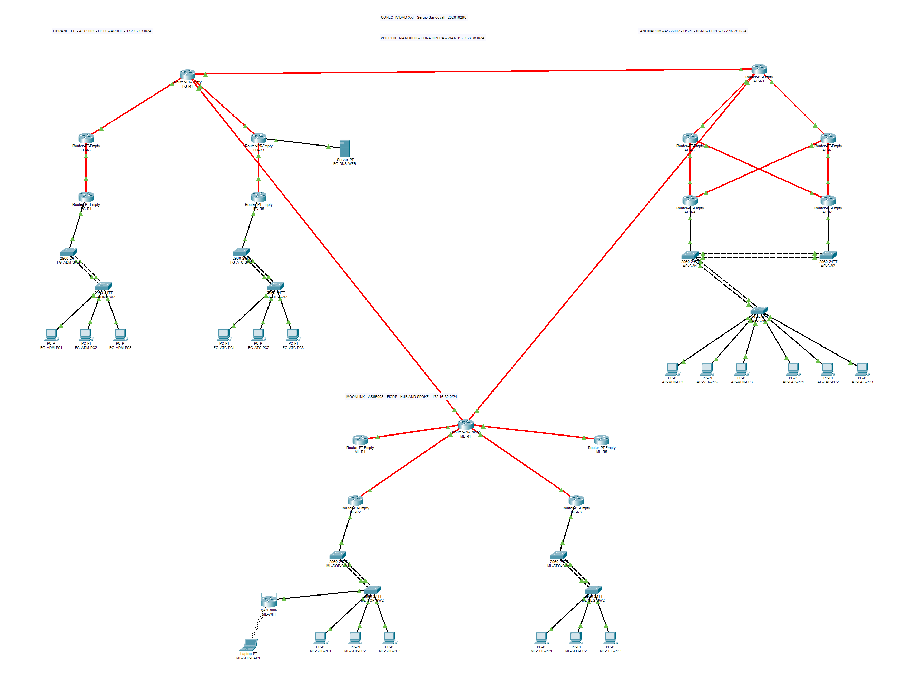

# Resultados verificados en Packet Tracer

Estas pruebas provienen del simulador. La [captura Wireshark de la VM](../Wireshark/ANALISIS_WIRESHARK.md) está completa y documenta por separado TCP, DNS, HTTP/HTTPS e ICMP con 42 tramas reales.

| Comprobación | Resultado | Evidencia |
|---|---|---|
| DHCP | 20 de 20 hosts finales con concesión dinámica válida | `hosts_dhcp.json` |
| ACL ICMP | 30 de 30 pares dirigidos coinciden con la política | `matriz_ping.json` |
| Web central | 14 de 14: HTTP y HTTPS desde seis departamentos y la laptop | `pruebas_web.json` |
| ACL TCP | 24 de 24 casos HTTP/HTTPS departamentales coinciden con la política | `pruebas_acl_web.json` |
| HSRP | Apagado real de AC-R4, toma de rol por AC-R5 y ping 4/4 | `prueba_hsrp.json` |
| LACP | Un miembro fuera de servicio en cada uno de seis grupos, seis pings 4/4 | `prueba_lacp.json` |

## Auditoría adicional del enunciado

| Comprobación | Resultado | Evidencia |
|---|---|---|
| ACL HTTP/HTTPS exhaustiva | 60/60 casos: 30 pares dirigidos por cada protocolo, con marcadores únicos | `auditoria_acl_60.json` |
| Sitio desde todos los hosts | 40/40: HTTP y HTTPS desde 18 PC, laptop y servidor | `auditoria_web_40.json` |
| Opciones DHCP | 20 hosts dinámicos, con máscara, gateway y DNS del diseño | `auditoria_web_40.json` |
| Configuración y protocolos | Consultas sin error en los 26 equipos IOS; configuraciones activa/de arranque coinciden | `auditoria/estado_cli.json` |
| Medio óptico | 17/17 enlaces entre routers con tipo óptico 8117 | `auditoria/estado_cli.json` |

Los seis servidores usados en la auditoría de ACL se retiraron al terminar. El sitio central se restauró a su página original después de los marcadores de prueba. Los resultados son registros reales, pero **faltan capturas de pantalla de ping y navegador de Packet Tracer** para satisfacer literalmente el entregable documental de 4.10. Consultar [la auditoría completa](../AUDITORIA_ENUNCIADO.md).

## Direcciones realmente concedidas

| Host | Interfaz | Dirección | Máscara | DHCP |
|---|---|---|---|---|
| FG-ADM-PC1 | FastEthernet0 | 172.16.18.21 | 255.255.255.128 | Sí |
| FG-ADM-PC2 | FastEthernet0 | 172.16.18.20 | 255.255.255.128 | Sí |
| FG-ADM-PC3 | FastEthernet0 | 172.16.18.22 | 255.255.255.128 | Sí |
| FG-ATC-PC1 | FastEthernet0 | 172.16.18.148 | 255.255.255.128 | Sí |
| FG-ATC-PC2 | FastEthernet0 | 172.16.18.150 | 255.255.255.128 | Sí |
| FG-ATC-PC3 | FastEthernet0 | 172.16.18.149 | 255.255.255.128 | Sí |
| FG-DNS-WEB | FastEthernet0 | 192.168.98.242 | 255.255.255.252 | Sí |
| AC-VEN-PC1 | FastEthernet0 | 172.16.28.21 | 255.255.255.192 | Sí |
| AC-VEN-PC2 | FastEthernet0 | 172.16.28.22 | 255.255.255.192 | Sí |
| AC-VEN-PC3 | FastEthernet0 | 172.16.28.23 | 255.255.255.192 | Sí |
| AC-FAC-PC1 | FastEthernet0 | 172.16.28.85 | 255.255.255.192 | Sí |
| AC-FAC-PC2 | FastEthernet0 | 172.16.28.84 | 255.255.255.192 | Sí |
| AC-FAC-PC3 | FastEthernet0 | 172.16.28.88 | 255.255.255.192 | Sí |
| ML-SOP-PC1 | FastEthernet0 | 172.16.32.11 | 255.255.255.192 | Sí |
| ML-SOP-PC2 | FastEthernet0 | 172.16.32.13 | 255.255.255.192 | Sí |
| ML-SOP-PC3 | FastEthernet0 | 172.16.32.10 | 255.255.255.192 | Sí |
| ML-SEG-PC1 | FastEthernet0 | 172.16.32.75 | 255.255.255.192 | Sí |
| ML-SEG-PC2 | FastEthernet0 | 172.16.32.74 | 255.255.255.192 | Sí |
| ML-SEG-PC3 | FastEthernet0 | 172.16.32.76 | 255.255.255.192 | Sí |
| ML-SOP-LAP1 | Wireless0 | 172.16.32.12 | 255.255.255.192 | Sí |

## Matriz final de ping

Filas: origen. Columnas: destino. `4/4` indica cuatro respuestas; `0/4` es un bloqueo esperado. No se presentan los bloqueos como pérdidas accidentales.

| Origen | ADM | ATC | VEN | FAC | SOP | SEG |
|---|---|---|---|---|---|---|
| ADM | - | 4/4 | 4/4 | 4/4 | 4/4 | 0/4 |
| ATC | 4/4 | - | 4/4 | 0/4 | 4/4 | 0/4 |
| VEN | 4/4 | 4/4 | - | 4/4 | 4/4 | 0/4 |
| FAC | 4/4 | 0/4 | 4/4 | - | 4/4 | 0/4 |
| SOP | 4/4 | 4/4 | 4/4 | 4/4 | - | 0/4 |
| SEG | 4/4 | 4/4 | 4/4 | 4/4 | 4/4 | - |

Las repeticiones de las pruebas que presentaron pérdida durante convergencia o resolución ARP se conservan en `previous_attempts`. La tabla muestra la ejecución final después de estabilizar la red.

## Pruebas HTTP/HTTPS de ACL

Se crearon temporalmente seis Server-PT departamentales, con DHCP y servicios reales HTTP/HTTPS. Se usó una página distinta por destino para distinguir una respuesta nueva de contenido anterior en el cliente. Tras las pruebas se retiraron esos seis equipos. Los 20 hosts de la entrega no incluyen esos servidores temporales.

| Origen | Destino | Protocolo | Esperado | Recibió página | Cumple |
|---|---|---|---|---|---|
| FG-ADM | ML-SEG | HTTP | Bloquear | No | Sí |
| FG-ATC | AC-VEN | HTTP | Permitir | Sí | Sí |
| AC-VEN | AC-FAC | HTTP | Permitir | Sí | Sí |
| AC-FAC | FG-ATC | HTTP | Bloquear | No | Sí |
| ML-SOP | FG-ADM | HTTP | Permitir | Sí | Sí |
| ML-SEG | ML-SOP | HTTP | Permitir | Sí | Sí |
| FG-ADM | FG-ATC | HTTP | Permitir | Sí | Sí |
| FG-ATC | AC-FAC | HTTP | Bloquear | No | Sí |
| AC-VEN | FG-ATC | HTTP | Permitir | Sí | Sí |
| AC-FAC | AC-VEN | HTTP | Permitir | Sí | Sí |
| ML-SOP | ML-SEG | HTTP | Bloquear | No | Sí |
| ML-SEG | FG-ADM | HTTP | Permitir | Sí | Sí |
| FG-ADM | AC-FAC | HTTPS | Permitir | Sí | Sí |
| FG-ATC | AC-VEN | HTTPS | Bloquear | No | Sí |
| AC-VEN | AC-FAC | HTTPS | Bloquear | No | Sí |
| AC-FAC | AC-VEN | HTTPS | Bloquear | No | Sí |
| ML-SOP | FG-ATC | HTTPS | Permitir | Sí | Sí |
| ML-SEG | AC-VEN | HTTPS | Permitir | Sí | Sí |
| FG-ADM | ML-SEG | HTTPS | Bloquear | No | Sí |
| FG-ATC | ML-SOP | HTTPS | Permitir | Sí | Sí |
| AC-VEN | FG-ADM | HTTPS | Permitir | Sí | Sí |
| AC-FAC | FG-ATC | HTTPS | Bloquear | No | Sí |
| ML-SOP | AC-FAC | HTTPS | Permitir | Sí | Sí |
| ML-SEG | FG-ATC | HTTPS | Permitir | Sí | Sí |

## Recuperación y persistencia

Todos los puertos usados para la prueba LACP se restauraron. AC-R4 se volvió a encender después de la prueba HSRP. La configuración efectiva se exportó en `../configs_aplicadas/`; el archivo `.pkt` se guardó después de restaurar los equipos.

## Ajustes detectados durante la validación

- Packet Tracer 9.0.1 utiliza el tipo de conexión óptica 8117 para estos módulos. El tipo `fiber` del MCP instalado usa un valor anterior y no creó los enlaces. Se identificó el tipo real mediante una conexión automática y se recrearon los enlaces previstos.
- Se enviaron los comandos mediante `CiscoDevice.enterCommand`, la API de la CLI. Así se evitó el error de análisis del helper que recibe bloques multilínea.
- Se permitieron específicamente los mensajes HSRP entre los dos gateways en las ACL de AndinaCom. Sin esa excepción ambos podían considerarse activos.
- Se asignaron costos OSPF diferentes a los enlaces redundantes de AndinaCom para obtener rutas principales y de respaldo deterministas.
- Se desactivó el DHCP del WRT300N. La laptop usa el SSID de laboratorio `Default`, se colocó dentro de la cobertura física y obtiene su concesión desde AC-R5.

## Captura real de la topología

