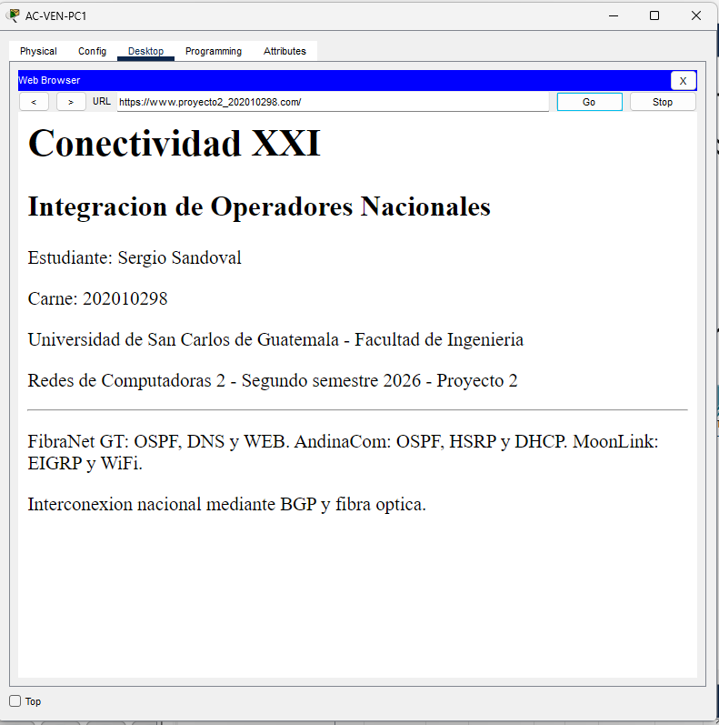

# Revisión de las ocho capturas aportadas

Revisión visual del 22/10/2026. Se conservaron los archivos originales sin recortar ni alterar resultados.

## Ping entre operadores

`082456`: AC-VEN-PC1 ejecuta `ping 192.168.98.242`, desde AndinaCom hacia el servidor de FibraNet. La ejecución final muestra cuatro enviados, cuatro recibidos y cero pérdida. También aparece una ejecución anterior con dos recibidos y 50 % de pérdida, entre dos pruebas satisfactorias. La imagen acredita conectividad recuperada/estable al final, pero no continuidad sin pérdida ni la causa de los timeouts. No atribuirlos a HSRP o ARP sin evidencia adicional del momento de la falla.

## DHCP de Seguridad y destino del bloqueo

`082531`: ML-SEG-PC1 tiene IPv4 por DHCP, IP `172.16.32.75`, máscara `255.255.255.192`, gateway `172.16.32.65` y DNS `192.168.98.242`. Coincide con el diseño y con la dirección usada en la siguiente prueba. La opción IPv6 Static aparece sin dirección global configurada: no es evidencia de IPv4 estática ni incumple el requisito DHCP IPv4 del proyecto.

## Bloqueo de Administración hacia Seguridad

`082623`: FG-ADM-PC1 hace ping a `172.16.32.75`. Se ven tres ejecuciones con cuatro enviados y cero recibidos; el gateway `172.16.18.1` devuelve Destination host unreachable. Esto es compatible con el bloqueo esperado de la ACL y se apoya en las configuraciones y la matriz de pruebas del repositorio. Un unreachable aislado no identificaría por sí solo una ACL; aquí se conoce el diseño y se acredita la IP del destino en la captura anterior. La parte superior también muestra un ping satisfactorio hacia Soporte.

## Sitio web por nombre y HTTP

`082703`: navegador de AC-VEN-PC1 con `http://www.proyecto2_202010298.com/`. La página muestra Sergio Sandoval, carné 202010298, universidad, curso, semestre y descripción del proyecto. Acredita la visualización por nombre mediante HTTP; la barra no dice HTTPS. La resolución DNS funcional se respalda además con las pruebas registradas, aunque la pantalla no muestra los paquetes DNS ni excluye el uso de caché.

## Sitio por HTTPS: captura final

`image.png`: navegador de AC-VEN-PC1 con `https://www.proyecto2_202010298.com/` visible y la página cargada. Se distinguen Sergio Sandoval, carné 202010298, universidad, curso y descripción del proyecto. Complementa la pantalla HTTP y completa la evidencia visual solicitada. La imagen acredita el acceso HTTPS simulado; el análisis del handshake y cifrado real corresponde a la captura de la VM.

## Estado HSRP de AC-R4

`082808`: el comando final, después de `enable`, funciona. Grupo 30: prioridad 115, Active local, respaldo `172.16.28.3`, IP virtual `172.16.28.1`. Grupo 40: prioridad 100, Standby, activo `172.16.28.67`, IP virtual `172.16.28.65`. Son los roles normales esperados. El primer Invalid input ocurrió en modo usuario y quedó corregido; no demuestra un error de configuración HSRP.

Los mensajes históricos muestran cambios de estado y vecinos OSPF, pero esta imagen no documenta de forma inequívoca qué equipo se apagó ni el estado simultáneo del otro gateway. Para una evidencia visual completa de conmutación, añadir el estado de AC-R5 durante la caída de AC-R4 y un ping después del cambio. La prueba automatizada de conmutación ya está en `../prueba_hsrp.json`.

## DHCP sobre WiFi

`082847`: ML-SOP-LAP1 usa Wireless0 con DHCP seleccionado, IP `172.16.32.12`, máscara `255.255.255.192`, gateway `172.16.32.1` y DNS `192.168.98.242`. Es coherente con Soporte y con el cliente inalámbrico. La imagen no muestra el SSID, la identidad del servidor DHCP ni una prueba de tráfico; esas comprobaciones se respaldan con la configuración del WRT y las pruebas web registradas.

## LACP de AndinaCom

`083147`: AC-SW1 muestra dos grupos: Po1(SU), LACP, Fa0/1(P) y Fa0/2(P); Po2(SU), LACP, Fa0/3(P) y Fa0/4(P). Ambos Port-channel están en capa 2 y en uso, con ambos miembros agregados. Los mensajes antiguos de enlace caído no cambian el estado final de la tabla. Esta captura acredita los dos grupos de AndinaCom; los otros cuatro grupos constan en los registros CLI de FibraNet y MoonLink.

## Dictamen de las imágenes

Con las ocho imágenes se cubren ping permitido, bloqueo hacia Seguridad, sitio HTTP y HTTPS, DHCP, WiFi y estado HSRP/LACP. Se da por completada esta parte de la documentación. Las pantallas adicionales de la conmutación HSRP son recomendables para complementar su prueba JSON, sin presentar el estado normal como si mostrara una falla controlada.
